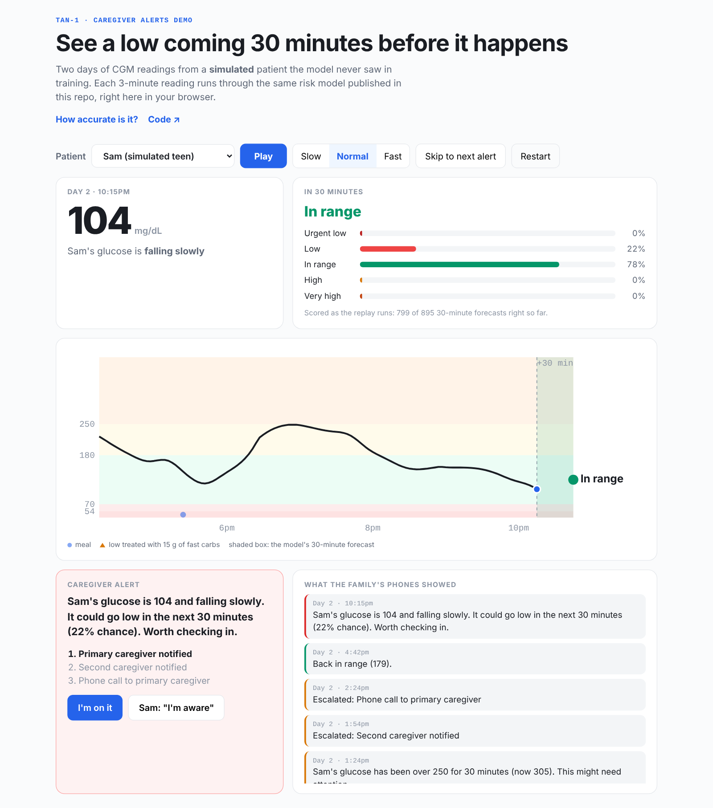
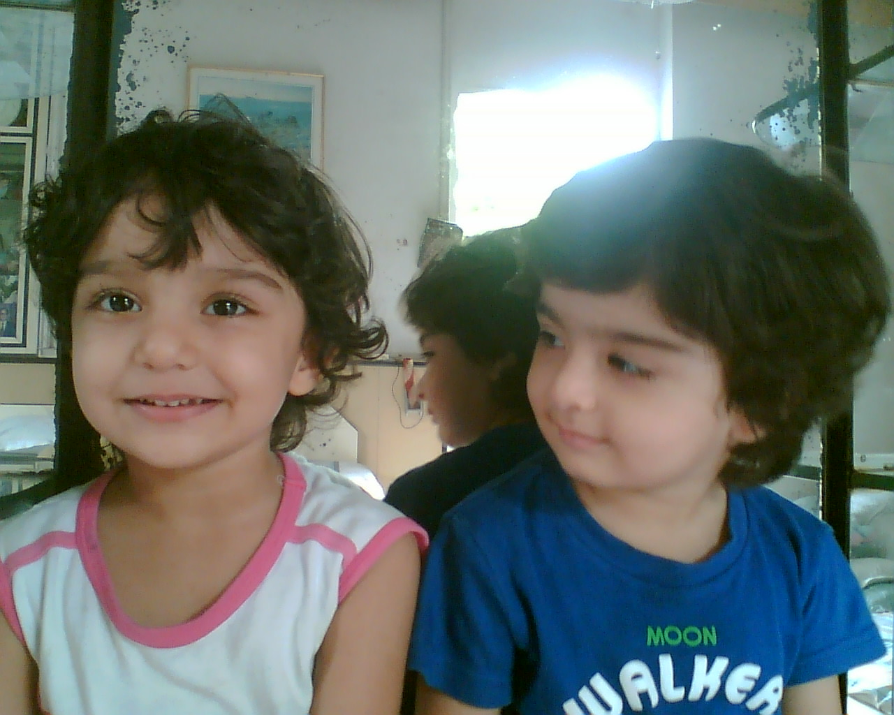
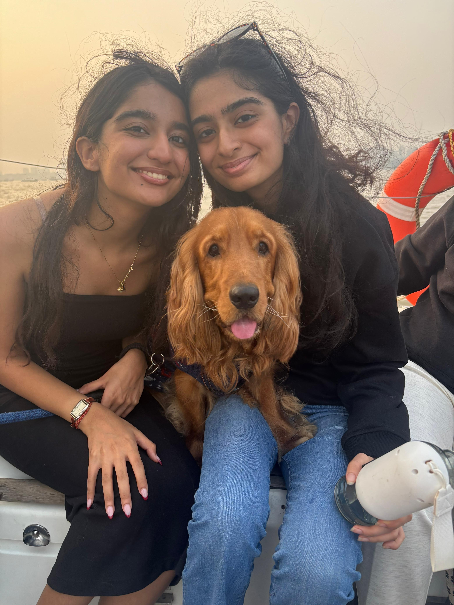
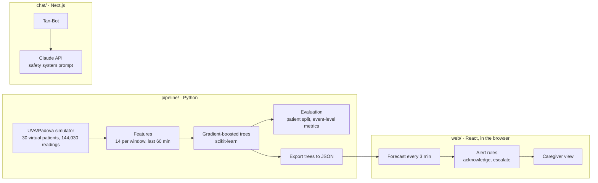

# TAN-1

**Glucose alerts a family can act on: a 30-minute low-glucose forecast, turned into calm, plain-English caregiver alerts with a one-tap "I'm on it".**

**[Try the caregiver demo](https://tanhemdev.github.io/TAN-1-PROTOTYPE/)** · two days of a simulated patient, replayed through the real model in your browser

[](https://github.com/tanhemdev/TAN-1-PROTOTYPE/actions/workflows/ci.yml)
[](https://github.com/tanhemdev/TAN-1-PROTOTYPE/actions/workflows/pages.yml)


<p align="center"></p>

## At a glance

| | |
|---|---|
| **Problem** | A CGM produces a reading every few minutes. Caregivers see a number and an arrow, can't tell when it matters, and don't know who in the family is handling it. |
| **Users** | Parents and partners of people with type 1 diabetes, and the person living with it |
| **Product** | 30-minute forecast → plain-English alert → one-tap acknowledge → escalation if nobody answers → 7am overnight summary. Plus Tan-Bot, a safety-bounded assistant for questions at 2am. |
| **Results** *(simulated patients)* | Warned about **96.6% of lows**, a median **21 minutes** ahead, with **47% fewer false alarms** than a trend-line rule |
| **Research** | 80+ interviews with people living with diabetes and their caregivers |
| **Recognition** | Pitched at UC Berkeley's BASICS Fall Pitch Day; [featured in Berkeley Letters & Science News](https://ls.berkeley.edu/news/cognitive-science-students-pitch-health-tech-ai-assistants-investors) |
| **My role** | Founder and PM: research, product definition, data and evaluation design, build |

## Why I built this

<p align="center">
  
  
  <br /><sub>My twin sister Tanisha and me, then and now</sub>
</p>

My twin sister Tanisha was diagnosed with type 1 diabetes. My family showed up in every way we knew how, but none of us could fully understand what she was going through: the 3am lows, the mental math before every meal, bracing for the sting of a new CGM sensor.

I interviewed over **80 people**, from pre-teens and college students to parents and senior citizens. Three things came up again and again: caregivers check the follow app constantly because they're afraid of missing the one reading that matters; numbers and arrows don't tell a non-medical parent whether to worry; and in families with more than one caregiver, nobody knows who's handling it. ([Research themes](docs/USER_RESEARCH.md))

TAN-1 is the product I wished Tanisha's family had.

## What a caregiver sees

Not "glucose: 247 mg/dL". Instead:

> **Sam's glucose is 104 and falling slowly. It could go low in the next 30 minutes (22% chance). Worth checking in.**
> [I'm on it] · [Sam: "I'm aware"]

| Need from research | What TAN-1 does |
|---|---|
| "Tell me *when* it matters" | Forecasts the glucose range 30 minutes ahead every 3 minutes, and alerts before a low, not after |
| "I can't read the arrow" | Plain-English alerts with context ("over 250 for 30 minutes"), never a bare number, never dosing advice |
| "Who's handling it?" | One-tap "I'm on it" that everyone sees; escalation to a second caregiver, then a call, if nobody answers |
| "Stop texting me about every high" | The person with diabetes can answer "I'm aware" themselves |
| "I set alarms to check at night" | Lows escalate fastest; a calm 7am overnight summary |
| "I need someone to ask at 2am" | Tan-Bot: warm answers with hard safety rules (no doses, emergencies to 911, crisis to 988) |

## Results (simulated patients)

Trained on 21 virtual patients and evaluated **once** on 9 it never saw (children, teens and adults; 90 days of CGM), against two rules an app could ship without machine learning.

| | TAN-1 model | Follow the trend line | Assume it stays the same |
|---|---|---|---|
| Lows warned about beforehand (of 117) | **96.6%** | 94.9% | none |
| False alarms per day | **1.41** | 2.66 | none |
| Median warning before the low | 21 min | **30 min** | none |
| Glucose range right, 30 minutes ahead | **87.2%** | 79.5% | 82.3% |

**Honest limits.** This is simulated data from the open-source UVA/Padova type 1 simulator, not real people, and simulated glucose is smoother than real CGM data, so real-world performance will be lower. On single readings the model pins down rare ranges poorly (it identifies about a quarter of urgent lows by exact range), which is why alerts use the combined chance of any low instead of the top prediction. Every number is reproducible from [results/metrics.json](results/metrics.json); the method is in [docs/METRICS.md](docs/METRICS.md).

## Product decisions and trade-offs

**1. Measure what a family feels, not just accuracy.** 87% range accuracy looked great but mostly reflected readings that were in range anyway. I added an event-level evaluation: of every time glucose dropped below 70, was there an alert beforehand, how early, and how many alerts were false alarms per day. That reframed the model from "classifier" to "alerting product".

**2. Pick the threshold on training data, and own the trade-off.** Alert fatigue is why people mute glucose apps, but missing a low breaks trust instantly. The alert threshold (a 20% chance of a low) was chosen with patient-level cross-validation on the training patients only: the highest threshold that still warned about 95% of lows. Result: 47% fewer false alarms than the trend line, for about 9 minutes less warning.

**3. Fix the data before trusting the model.** The simulator's stock dosing drove some virtual patients to glucose readings of zero, a state no real person stays in, and a model trained on that looks accurate for the wrong reason. I caught it by profiling the data (time below range per patient), then rebuilt the dosing the way pumps and families actually work: insulin-on-board-aware corrections, 15 g carbs for every low, per-patient titration to the consensus targets, plus everyday mistakes. Result: about 76% of readings in range and under 5% below 70, in line with real-world type 1 patterns.

**4. No leakage.** Train and test are split by patient, not by time, so every test forecast is for a person the model has never seen.

**5. Privacy by design.** No real patient data anywhere in this repo. The trained model is exported to JSON and runs in the browser, so readings never leave the device; tests prove the browser and Python give identical answers.

**6. Responsible AI.** Alerts say that something needs attention, never what dose to take. Tan-Bot's system prompt forbids dosing advice and routes emergencies to 911 and crisis to 988, and its inputs are validated and length-limited before reaching the model.

## How it's built



| Part | What | Tech |
|---|---|---|
| [`pipeline/`](pipeline) | Simulate patients, build features, train, evaluate, export | Python, scikit-learn, pandas, NumPy, simglucose |
| [`web/`](web) | Caregiver demo: model in the browser, alerts, acknowledge, escalation | React, esbuild |
| [`chat/`](chat) | Tan-Bot | Next.js, Claude API |
| [`.github/workflows/`](.github/workflows) | Tests, builds and the demo deploy on every push | GitHub Actions, GitHub Pages |

Design details: [docs/ARCHITECTURE.md](docs/ARCHITECTURE.md).

## Quality

- **29 automated tests** plus a browser test: simulator sanity (no collapse to zero, lows get treated, reproducible), features and consensus cut-offs, model export, the event metrics, alert wording and escalation, Python/JavaScript parity on 300 held-out windows, Tan-Bot input checks, and the built demo end to end in headless Chromium.
- **CI** runs all of it, plus the demo and Next.js builds, on every push.
- **Reproducible:** every random choice is seeded; `python pipeline/simulate.py && python pipeline/train.py` regenerates the data, model and every number above.

## Run it

```bash
pip install -r requirements-dev.txt
python pipeline/simulate.py      # about 30 minutes; data/ already has the output
python pipeline/train.py         # about a minute: metrics, model.json, demo data
pytest -q pipeline/tests

cd web && npm install && npm test && npm run build    # demo in web/dist
cd chat && npm install && npm test                    # Tan-Bot: set ANTHROPIC_API_KEY, then npm run dev
```

## What's next

| Next | Success looks like |
|---|---|
| Validate on real, consented CGM data | Required before any pilot |
| Dexcom partner API and push notifications | Alerts reach a phone in under a minute |
| Family pilot | 90%+ of lows warned 15+ minutes ahead, under 1 false alarm a day, follow-app checks going down |
| Peer community | People living with the same condition can find each other |

TAN-1 is a prototype, not a medical device, and it never gives dosing advice.

## Docs

[PRD](docs/PRD.md) · [User research](docs/USER_RESEARCH.md) · [Architecture](docs/ARCHITECTURE.md) · [Build log](docs/SPRINT_LOG.md) · [Metrics](docs/METRICS.md)

---

*To Tanisha: this journey is not even 1% of what you go through every single day. But if it helps even one person feel a little less alone, I think it's worth everything.*

MIT licensed. The vendored simulator in `pipeline/third_party/simglucose` keeps its own MIT license. Built by [Tanya Hemdev](https://tanyahemdev.com), UC Berkeley.
