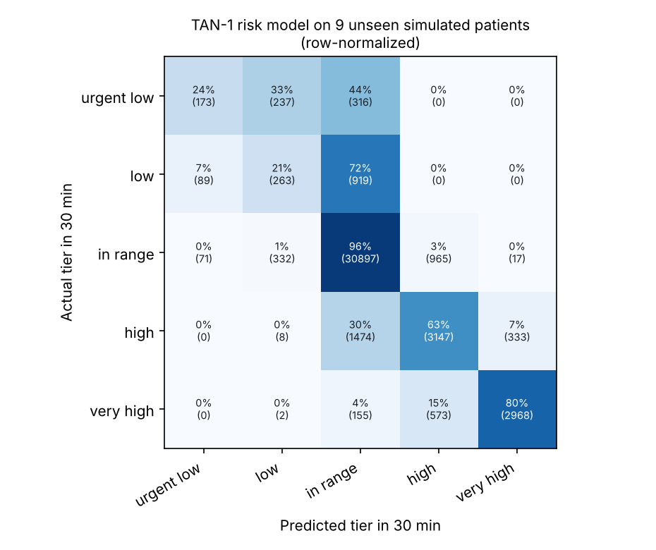

# TAN-1: Metrics

Everything on this page is measured on **simulated** patients (UVA/Padova simulator) and comes from `results/metrics.json`, which `python pipeline/train.py` regenerates. There is no real-patient data in TAN-1 yet, so there are no real-world results.

## Data

| | |
|---|---|
| Virtual patients | 30 (10 children, 10 adolescents, 10 adults), 10 days each |
| CGM readings | 144,030 (every 3 minutes) |
| Train / test | 21 patients (100,191 forecasts) / **9 unseen patients** (42,939 forecasts, 90 days) |
| Test ranges, 30 min ahead | in range 75%, high 12%, very high 9%, low 3%, urgent low 2% |

The simulated population lands near real-world glucose patterns: 76% of readings in range overall, 4.6% below 70 and 1.2% below 54 (children more variable than adults). See [ARCHITECTURE.md](ARCHITECTURE.md) for how dosing, low treatment and mistakes are simulated.

## 1. Forecasting the range 30 minutes ahead

| | Accuracy | Balanced accuracy | Macro-F1 |
|---|---|---|---|
| **TAN-1 model** | **87.2%** | 56.8% | **0.60** |
| Assume it stays in the same range | 82.3% | 57.0% | 0.57 |
| Follow the trend line | 79.5% | **66.0%** | 0.56 |

Per range for the model (precision / recall): in range 92% / 96%, high 67% / 63%, very high 89% / 80%, low 31% / 21%, urgent low 52% / 24%.

**Reading this honestly.** Accuracy is high mostly because most readings are in range. The trend line has the best balanced accuracy because it calls the rare ranges more often, at the cost of many wrong calls. The rare, important ranges are hard to pin down exactly: the model often puts an upcoming low in the neighboring range. That's why alerts don't wait for "low" to be the model's top answer. They use the combined chance of *any* low, below.

## 2. Low alerts, judged the way a family would

Per-reading scores don't say what matters to a caregiver. So the alert logic is also scored per event:

- **A low** is glucose dropping below 70 (drops less than 30 minutes apart count once). The 9 test patients had **117**.
- **Warned about beforehand** means an alert fired in the 30 minutes before glucose went below 70.
- **A false alarm** is an alert after which glucose stayed at or above 70 for 45 minutes.

| | Lows warned about | Median warning | Alerts | False alarms per day | Alerts followed by a low |
|---|---|---|---|---|---|
| **TAN-1 model** (alert at a 20% chance of a low) | **96.6%** (113 of 117) | 21 min | 215 | **1.41** | **41%** |
| Follow the trend line (alert if it projects below 70) | 94.9% (111 of 117) | **30 min** | 305 | 2.66 | 22% |

**The trade-off:** the model catches slightly more lows with 47% fewer false alarms, and gives about 9 minutes less warning than the trend line. False alarms are the top reason people silence glucose apps, so this is the trade TAN-1 makes. With real data the threshold would be revisited with families.

### How the threshold was chosen

On the 21 **training** patients only: three-fold cross-validation by patient produced out-of-fold predictions, and the highest threshold that still warned about at least 95% of their lows was 20%. The test patients were scored once, afterwards.

| Threshold | Training lows warned about | Training false alarms per day |
|---|---|---|
| 10% | 99.0% | 1.86 |
| 15% | 96.5% | 1.54 |
| **20%** | **96.2%** | **1.26** |
| 25% | 94.1% | 1.08 |
| 30% | 90.0% | 0.88 |
| 40% | 79.6% | 0.57 |
| 50% | 66.1% | 0.33 |

## 3. Browser matches Python

On 300 held-out windows (`web/tests/parity.test.mjs`): JavaScript features equal Python's to 1e-9, the JavaScript tree evaluator equals scikit-learn to 1e-6 on the same features, and the predicted range is identical in every case end to end.

## Tests

| Suite | What it covers |
|---|---|
| `pipeline/tests` (11) | Simulator sanity (no collapse to zero, lows get treated, reproducible), features, consensus cut-offs, model export, the event metrics above |
| `web/tests` (12) | Alert wording and rules, escalation timing, patient self-acknowledge, overnight summary, Python/JS parity |
| `web/tests/e2e.mjs` | The built demo in headless Chromium: replay, accuracy table matches `metrics.json`, alerts without dosing advice, acknowledge, phone layout |
| `chat/tests` (6) | Tan-Bot input checks |

## What will be measured with real families (targets, not results)

| Metric | Target |
|---|---|
| Lows warned about 15+ minutes ahead | 90%+ |
| False alarms per day | Under 1 |
| Median time to "I'm on it" | Under 10 minutes |
| Caregiver checks of the follow app per day | Going down |
| Caregiver-reported worry | Going down |
